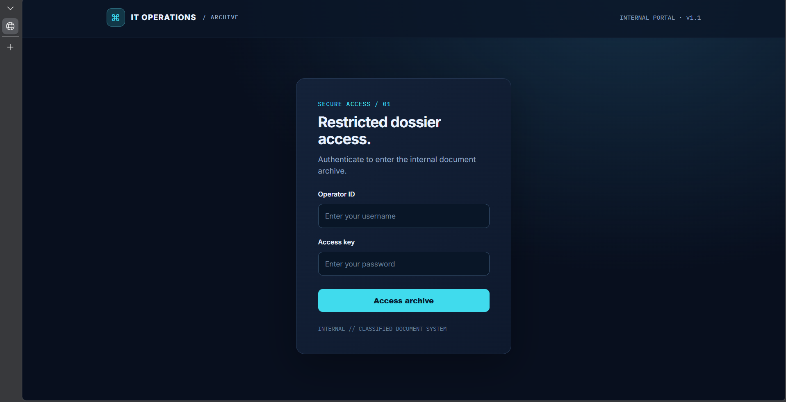
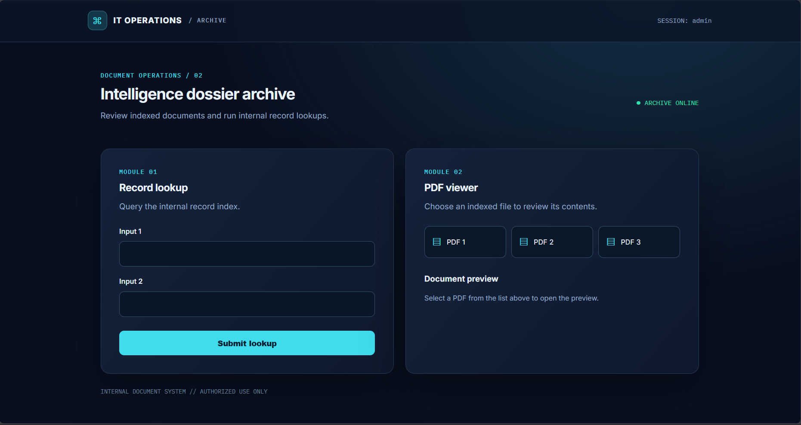
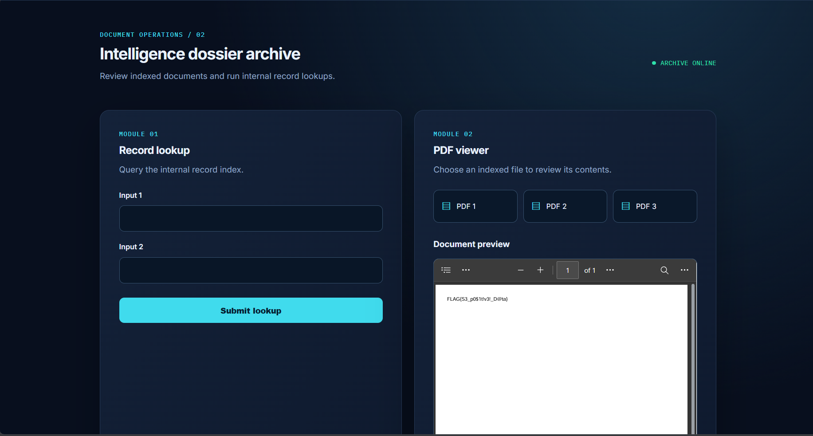

**Challenge Name:- 𓂀Blindfolded**

**Step-1:** Open the challenge website. You will see the **Restricted dossier access** login page.



**Step-2:** Enter the following SQL injection payload to bypass the login:

**Username:** `admin`

**Password:**

```sql
' OR '1'='1' -- 
```

Click **Access archive**. After successful authentication, you will be redirected to the **Intelligence dossier archive** dashboard.



**Step-3:** On the dashboard, you will find two sections: **Record lookup** and **PDF viewer**.

Open the available PDF files and check the hints inside them:

- **PDF 1:** `GO`
- **PDF 2:** `9`
- **PDF 3:** `9`

The hints indicate the hidden document **pdf99**.

**Step-4:** Inspect the PDF viewer's document request or link, and change the requested PDF identifier to `pdf99` (using the identifier format shown by the application). Open the hidden PDF to retrieve the flag.



**Flag: `flag{S3_p0$1t!v3!_D@ta}`**
