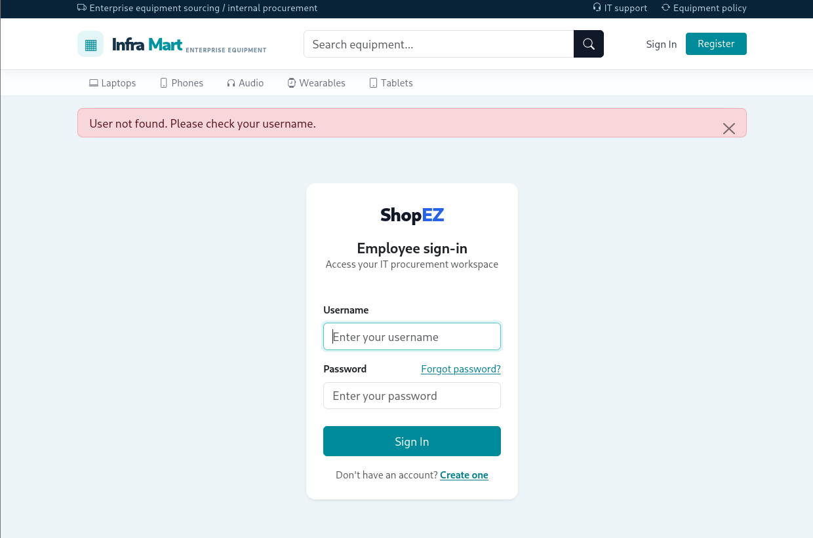
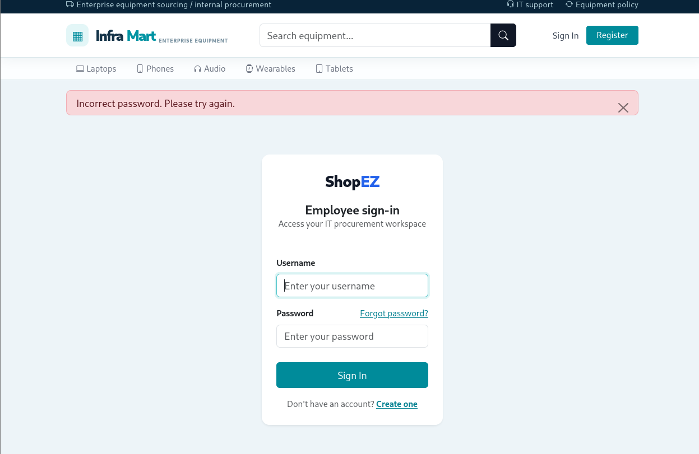
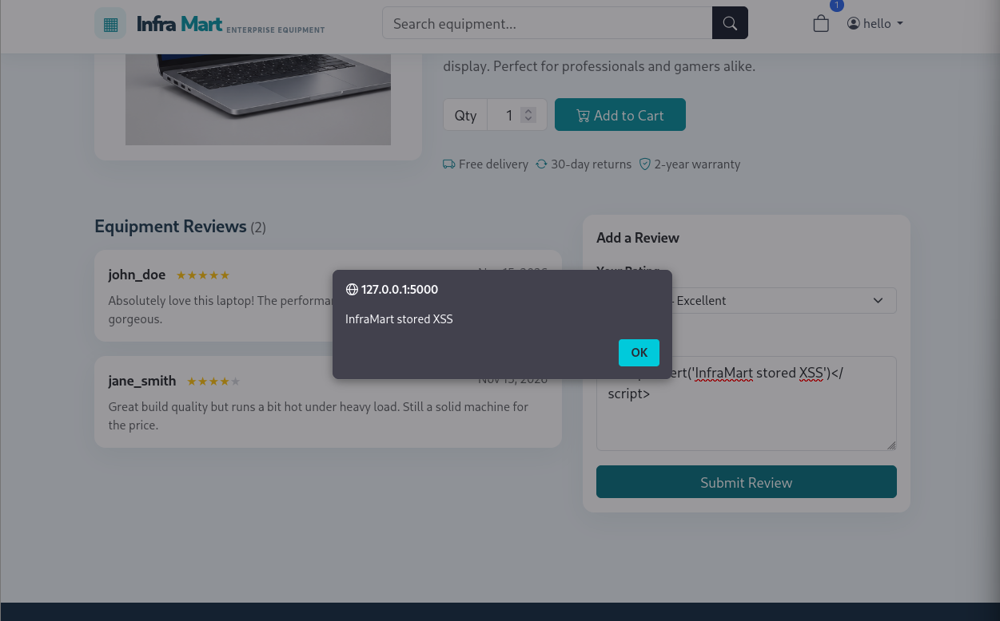
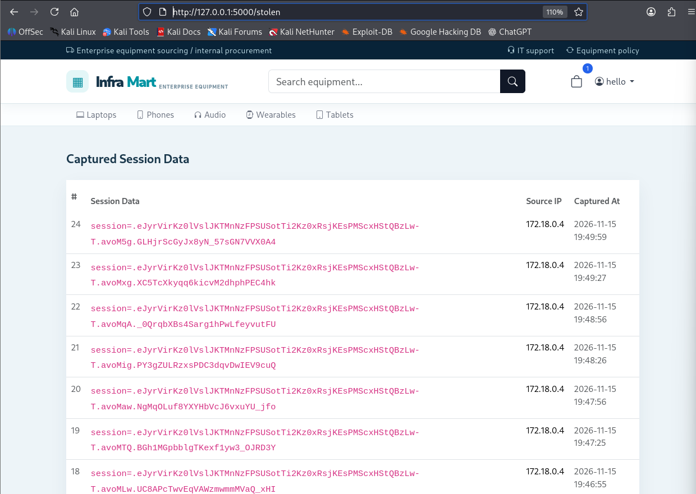
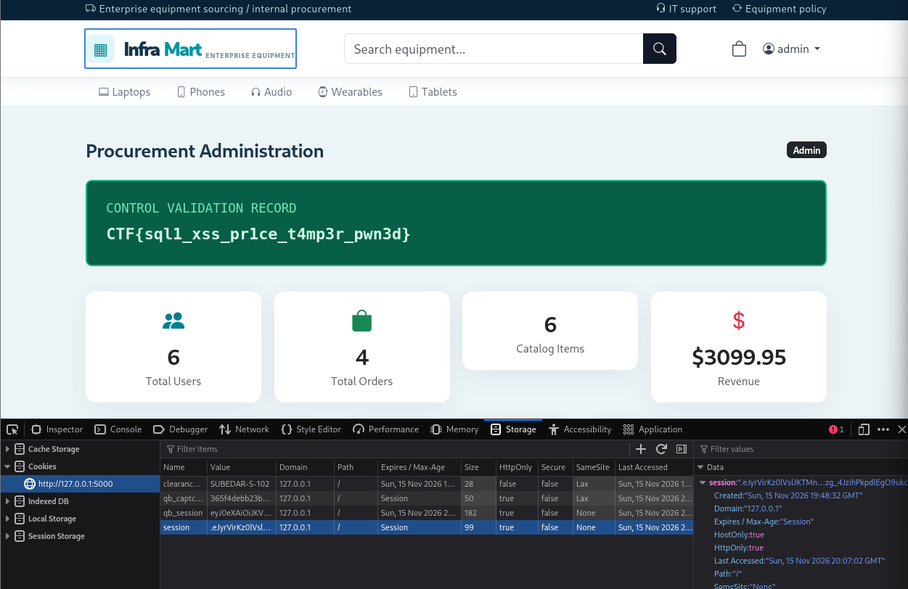

# InfraMart — CTF Solution Writeup

**Challenge Name:** InfraMart  
**Category:** Web Security  
**Edition:** UI-Only  
**Target:** `http://TARGET-IP:5000`  
**Final Flag:** `CTF{sql1_xss_pr1ce_t4mp3r_pwn3d}`

> This writeup covers the **InfraMart UI-Only** challenge, not the separate Validated Offline version. In this edition, the admin bot simulates session collection; it does **not** execute JavaScript. The price-tampering vulnerability is independent of the flag retrieval and is outside the screenshots captured here.

## Step 1 — Username Enumeration

Open the login page:

`http://TARGET-IP:5000/login`

First attempt a login with a username that does not exist:

```text
Username: ghost_user
Password: anything
```

The application displays:

```text
User not found. Please check your username.
```

**Screenshot 1 — Unknown username error**



Next test the suspected administrator username with an incorrect password:

```text
Username: admin
Password: wrongpassword
```

The application displays a different error:

```text
Incorrect password. Please try again.
```

**Screenshot 2 — Existing username, incorrect password**



Different login errors disclose that `admin` is a valid username. This is **username enumeration**, not SQL injection.

## Step 2 — Stored Cross-Site Scripting (XSS)

Register a normal account at:

`http://TARGET-IP:5000/register`

Log in, visit `http://TARGET-IP:5000/product/1`, and locate **Equipment Reviews → Add a Review**.

Submit this test payload:

```html
<script>alert('InfraMart stored XSS')</script>
```

Refresh the product page. A JavaScript alert with the message `InfraMart stored XSS` confirms that stored review content is executed by the browser.

**Screenshot 3 — Stored XSS alert**



The underlying problem is rendering untrusted review data with the Jinja2 `|safe` filter, which disables normal HTML escaping. The alert proves stored XSS in a regular browser; it does **not** prove administrator cookie theft by the bot.

## Step 3 — Administrator Session Exposure

Open:

`http://TARGET-IP:5000/stolen`

The publicly readable **Captured Session Data** page lists collected cookies. Look for a captured record beginning with:

```text
session=<cookie_value>
```

Copy the value *after* `session=`; do not copy the prefix itself.

**Screenshot 4 — Exposed session records**



**Important:** In this UI-Only edition, the supplied admin bot automatically sends its own authenticated session cookie to `/steal`, which makes it visible at `/stolen`. This happens independently of the stored-XSS payload. The cookie is a **Flask signed session cookie**, not a JWT; this is **session replay**, not a JWT `alg:none` exploit.

## Step 4 — Administrator Session Replay and Flag Retrieval

In Firefox on `http://TARGET-IP:5000`, press **F12** and navigate to **Storage → Cookies**.

Select the application's origin and locate the cookie named:

```text
session
```

Replace its entire value with the captured administrator session value from Step 3, without the `session=` prefix. If the cookie is absent, sign in as a regular user first so Firefox has a `session` entry to edit.

Navigate to:

`http://TARGET-IP:5000/admin/dashboard`

If the cookie is valid and belongs to the administrator, the **Procurement Administration** page appears with the **CONTROL VALIDATION RECORD** and flag.

**Screenshot 5 — Administrator dashboard and final flag**



## Final Flag

```text
CTF{sql1_xss_pr1ce_t4mp3r_pwn3d}
```

## Vulnerabilities Demonstrated

| Finding | Evidence |
| --- | --- |
| Username enumeration | Distinct messages for unknown username versus incorrect password |
| Stored XSS | Product review triggers JavaScript alert after being stored |
| Public session exposure | `/stolen` displays admin-bot session records |
| Administrator session replay | Reusing a valid `session` cookie unlocks the admin dashboard |

**Scope note:** The UI-Only organizer solution also documents checkout **price tampering**: editing the submitted `total_price` field to `0`. It is a separate vulnerability and **not needed** to retrieve this flag; its screenshot was intentionally omitted from this writeup.
