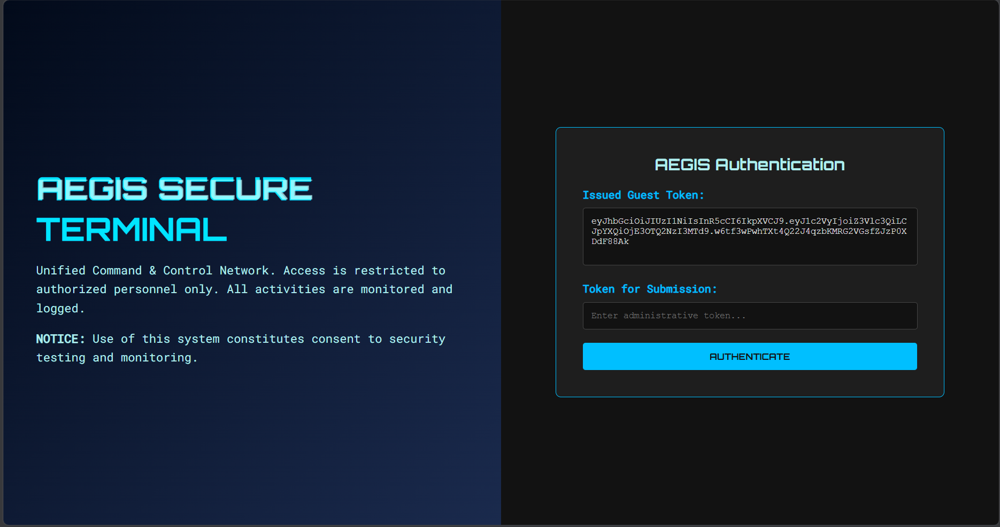
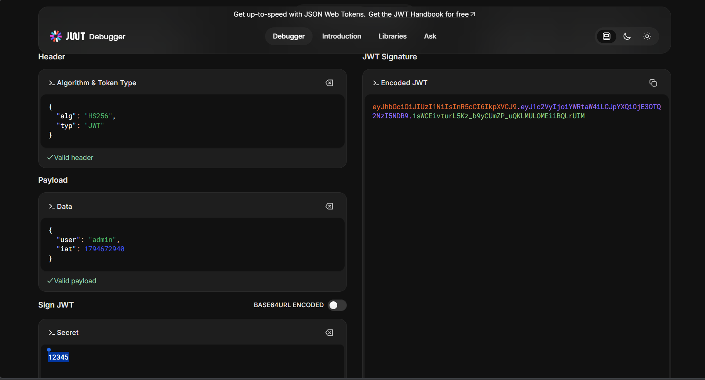
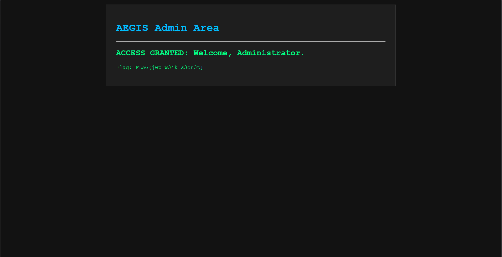

# Operation Trident Token — CTF Solution

**Step-1:** Open the challenge website. The AEGIS Authentication page displays an **Issued Guest Token**. Copy the guest JWT.



**Step-2:** Right-click and select **View Page Source** (or press `Ctrl + U`). Inspect the source of `index.php` for a developer comment revealing the JWT signing secret.

**Secret Key:** `12345`

**Step-3:** Open https://jwt.io and paste the guest JWT into the **Encoded JWT** field. In the decoded payload, change the `user` value from `guest` to `admin`, keeping other existing claims unchanged.

Before:

```json
{
  "user": "guest"
}
```

After:

```json
{
  "user": "admin"
}
```

**Step-4:** Under **Sign JWT → Secret**, enter `12345`. Keep the **HS256** signing algorithm shown in the token header. Copy the newly signed JWT from the **Encoded JWT** field.



**Step-5:** Return to the challenge page, paste the forged admin JWT into **Token for Submission**, and click **AUTHENTICATE**. The AEGIS Admin Area should display the flag.



**Flag (as provided in the solution text):** `flag{jwt_w34k_s3cr3t}`

> **Verification note:** The supplied admin-area screenshot displays `FLAG{jwt_w34k_s3cr3t}` with uppercase `FLAG`, while the supplied solution text uses lowercase `flag`. Confirm which casing the challenge validator accepts before publishing a definitive flag.
